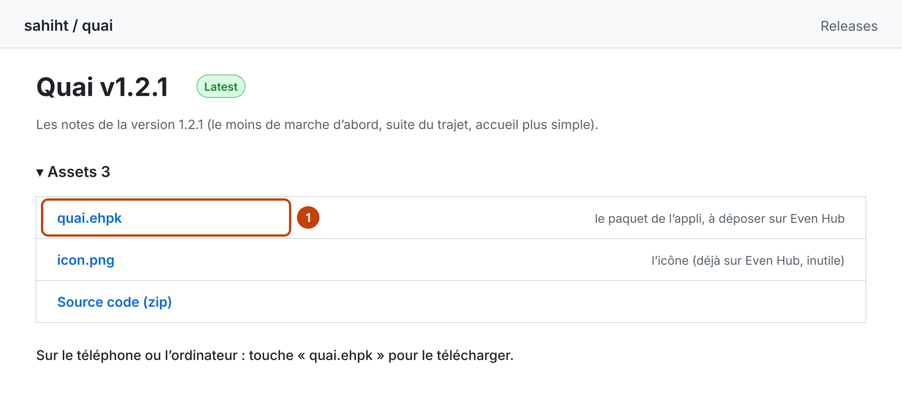
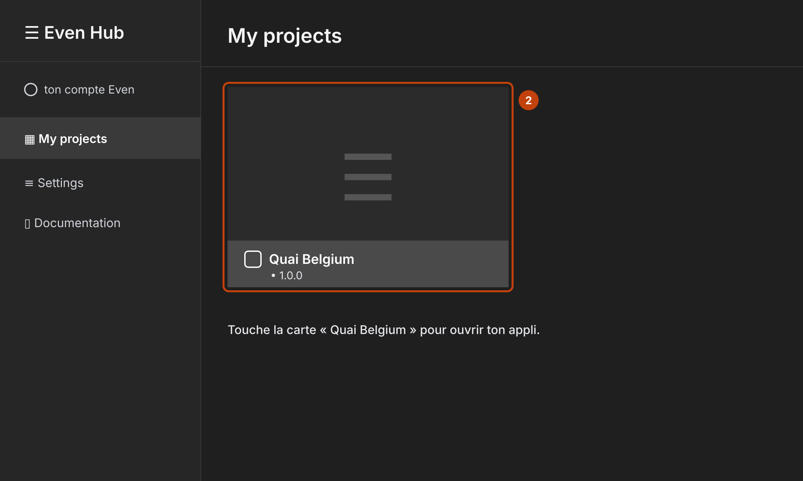
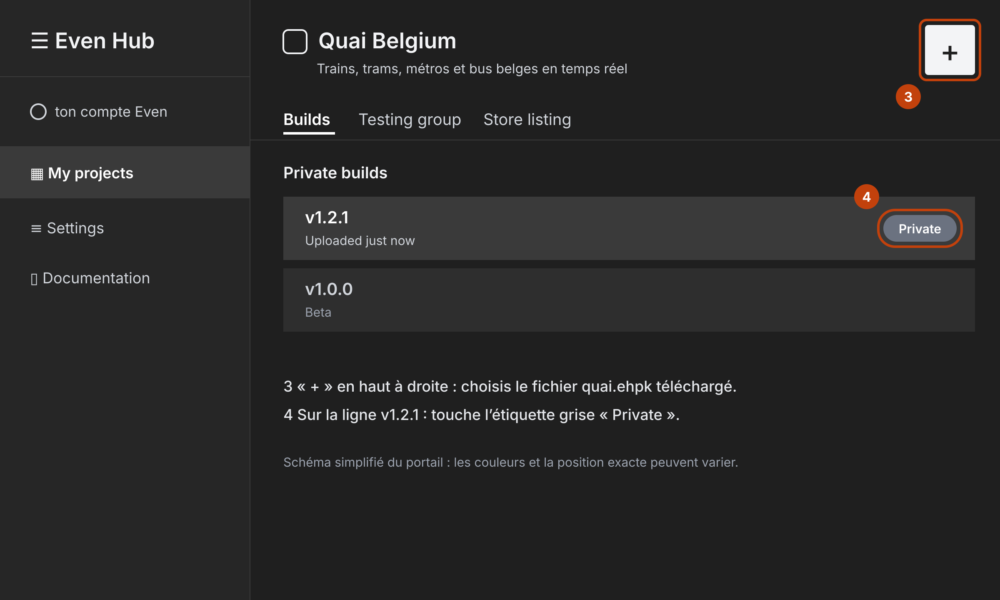
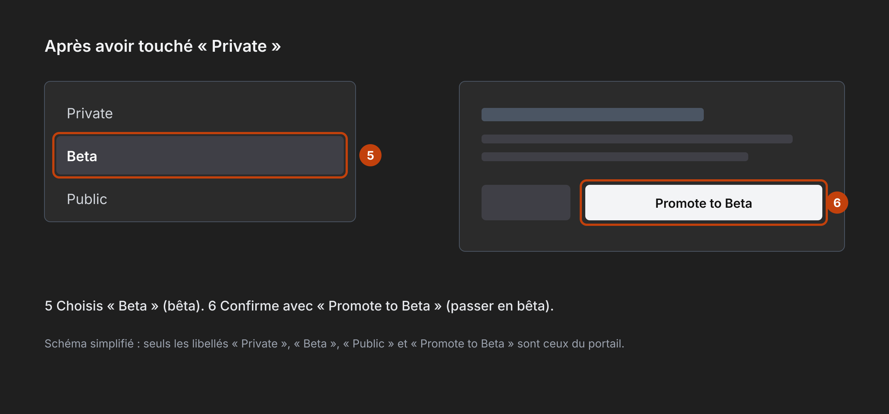
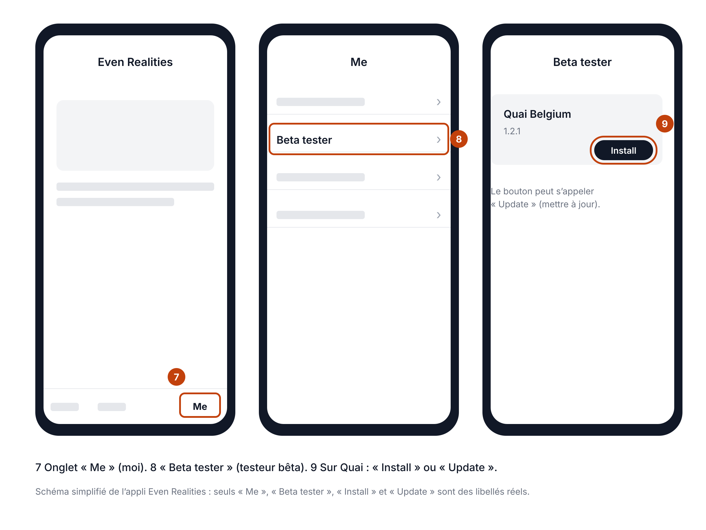

# Passer Quai à une nouvelle version (bêta)

Ce guide sert à chaque nouvelle version de Quai. La dernière est la 1.2.1. Il faut environ 10 minutes, un ordinateur (ou le téléphone) pour le portail Even Hub, puis le téléphone.

## Ce qui change avec la 1.2.1

- Le moins de marche d'abord : en tête, le trajet le plus rapide parmi ceux qui marchent le moins. Plus de marche seulement s'il n'y a pas mieux, par paliers de 5 min, et jamais un détour qui ferait arriver plus de 30 min plus tard.
- Sur un trajet, ▲▼ fait défiler les étapes. Au bout, « Fin du trajet », puis ▼ ouvre la liste « Autres trajets », chacun avec ses moyens (« bus W + S1 ») et la raison de sa place.
- Accueil des lunettes plus simple : « Favoris », avec en dessous tes favoris du moment, une ligne chacun, puis « Autour de moi » et « Aller à… ». Les jours fériés sont signalés.
- Nouveau favori, sur le téléphone : « Un endroit » ou « Un trajet de A à B », au choix en haut de l'écran.

Si tu viens d'une version antérieure à la 1.2 : tes lieux sont maintenant des favoris, dans une seule liste, et Quai Web accepte une adresse comme position.

## Ce qui se met à jour tout seul

- Les horaires : chaque nuit, sans rien faire.
- Le relais (temps réel et adresses) : il se met à jour seul sur Vercel quand son code change sur GitHub.
- Quai Web : il passe seul à la nouvelle version, à la même adresse.
- Tes réglages : tes favoris, leur ordre et tes choix d'affichage sont repris par la nouvelle version. Depuis la 1.2, tes lieux font partie de tes favoris, sans doublon. Ils sont gardés dans l'appli Even Realities, sur ton téléphone.

Seule l'appli des lunettes demande ton geste : déposer le nouveau paquet sur Even Hub, le passer en bêta, puis l'installer sur le téléphone.

## Quand mettre à jour ?

Quand une nouvelle version est publiée sur GitHub (page « Releases » du dépôt). Une version porte toujours un numéro plus grand que la précédente : Even Hub refuse un numéro déjà déposé.

## Les étapes

### 1. Télécharger le paquet

Ouvre https://github.com/sahiht/quai/releases/latest. La page s'appelle « Quai v1.2.1 ». Dans « Assets » (fichiers joints), touche `quai.ehpk` pour le télécharger. L'icône ne change pas : inutile de la reprendre.

### 2. Ouvrir ton appli sur Even Hub

Va sur https://hub.evenrealities.com et connecte-toi avec le même compte que dans l'appli Even Realities. Dans « My projects » (mes projets), touche la carte « Quai Belgium ».

### 3. Déposer le nouveau paquet

Onglet « Builds » (paquets). Touche le bouton « + » en haut à droite et choisis le fichier `quai.ehpk` téléchargé. Une ligne « v1.2.1 » apparaît sous « Private builds » (paquets privés), avec une étiquette grise « Private » (privé).

### 4. Passer la version en bêta

Sur la ligne « v1.2.1 », touche l'étiquette grise « Private ». Choisis « Beta » (bêta), puis confirme avec « Promote to Beta » (passer en bêta).

Inutile de te réinviter dans « Testing group » : ton accès de testeur reste actif d'une version à l'autre.

### 5. Installer sur le téléphone

Dans l'appli Even Realities : onglet « Me » (moi), puis « Beta tester » (testeur bêta). Sur Quai, touche « Install » (installer) ou « Update » (mettre à jour).

### 6. Ouvrir Quai sur les lunettes

À la première ouverture, les lunettes affichent une fois le message « Quai 1.2.1 » avec les nouveautés. Touche pour continuer.

### 7. Vérifier

Sur le téléphone, ouvre Quai, puis « Données » : la ligne « Version de Quai » doit dire « 1.2.1 ». Dans les lunettes, l'accueil commence par « Favoris », avec tes favoris du moment en dessous.

## En cas de souci

| Ce que tu vois | Ce qu'il faut faire |
|---|---|
| Even Hub refuse le fichier | Ce numéro de version est déjà déposé. Vérifie que tu as bien pris le paquet de la dernière release. |
| « test version expired » sur le téléphone | La version n'est pas en « Beta », ou ton invitation n'est plus « Active » dans « Testing group ». |
| Les lunettes montrent encore l'ancienne version | Quitte Quai (double toucher à l'accueil), puis rouvre-le. Sur le téléphone, vérifie dans « Beta tester » que la version 1.2.1 est installée. |
| Un trajet propose plus de marche que ton réglage | Quai n'a pas trouvé de trajet avec nettement moins de marche qui arrive moins de 30 min plus tard. Au bout des étapes, ▼ ouvre les autres trajets. Tu peux aussi changer « Marche maximale » en bas de « Mes favoris ». |
| « Adresses indisponibles pour l'instant » | Le service d'adresses ne répond pas. Les gares et les arrêts restent utilisables ; réessaie plus tard. |
| La première recherche de trajet est lente | Normal : Quai télécharge une fois les lignes utiles (environ 0,5 à 1 Mo), puis les garde sur le téléphone. |
